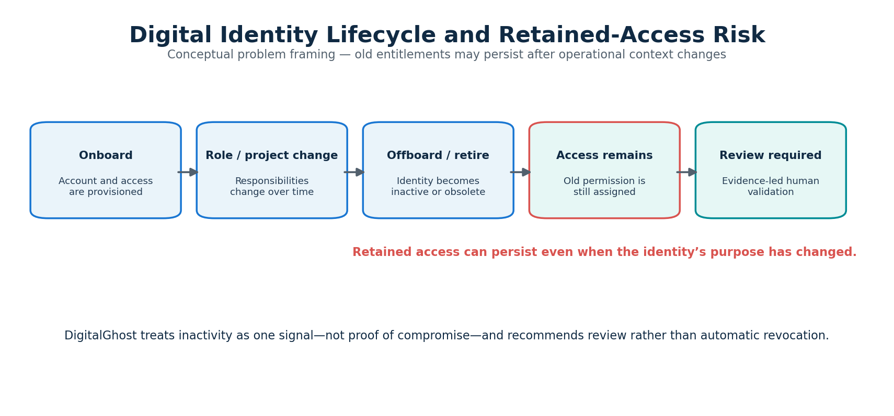
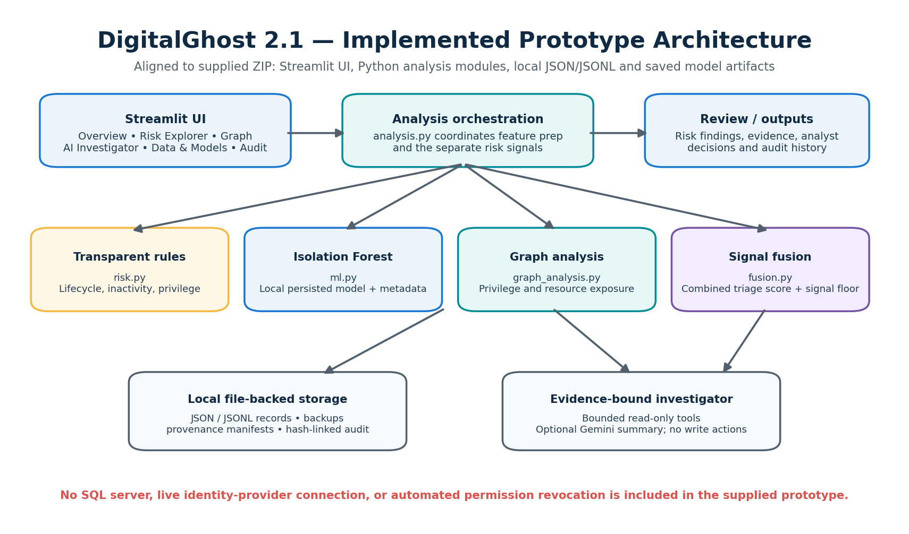
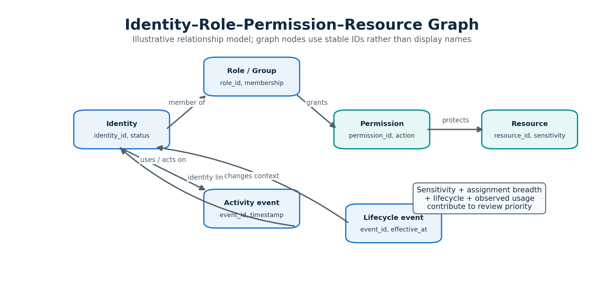
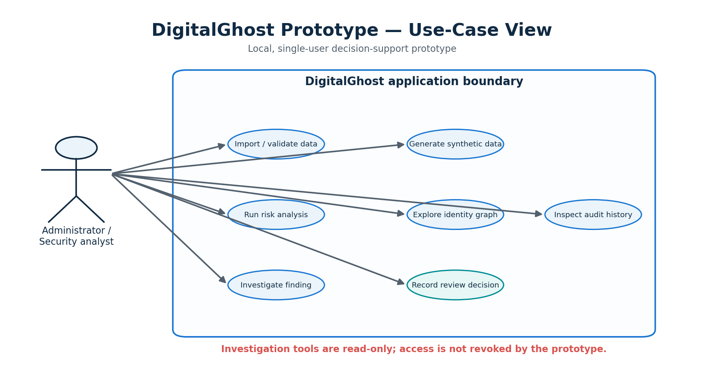
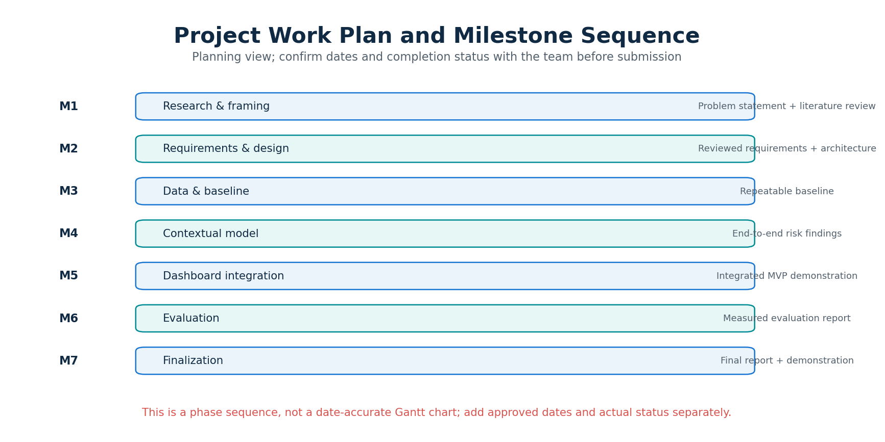
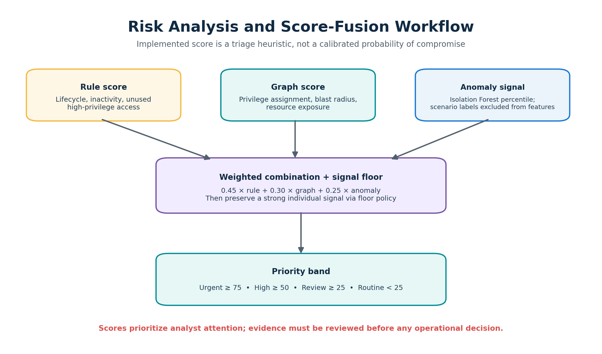
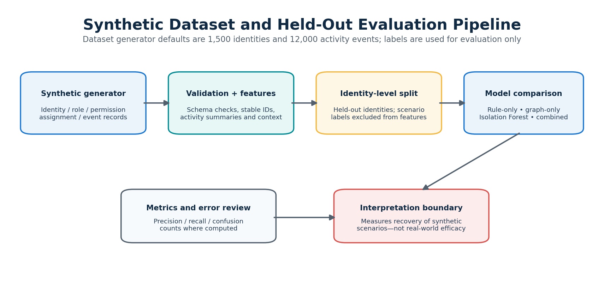
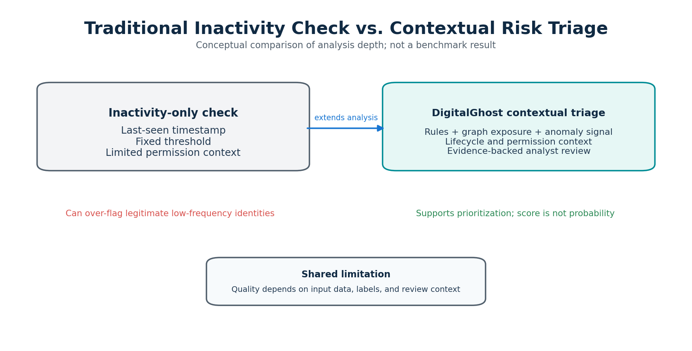
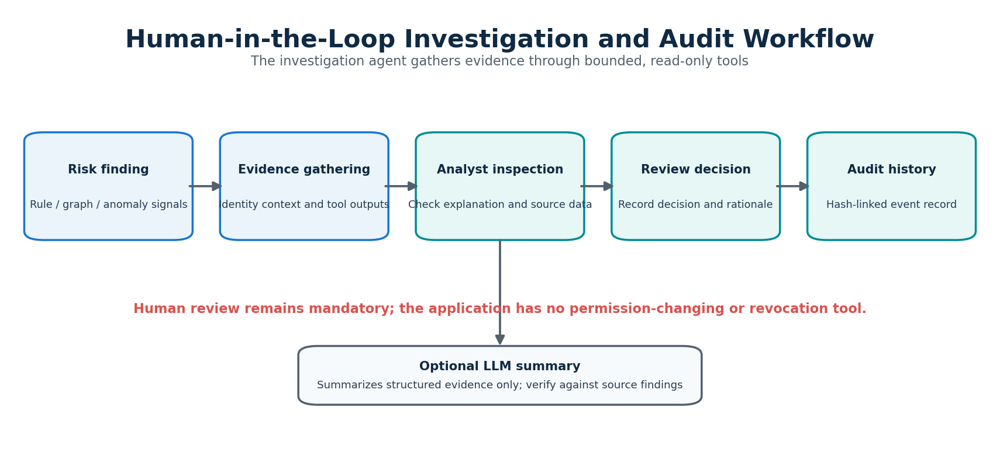

# DigitalGhost — Local Identity Risk Intelligence

**DigitalGhost** is a local-first prototype for investigating potentially risky identity access and retained-access risk. It combines transparent rule-based scoring, a persisted Isolation Forest anomaly signal, graph-based permission analysis, a bounded read-only investigation agent, and an optional LLM summary — all running on your machine with no external identity provider and no automatic remediation.


*Identity lifecycle: old entitlements can persist after operational context changes.*

## What DigitalGhost does

DigitalGhost is built for security analysts and researchers who need a transparent, explainable view of identity risk — not a black-box score. Every signal is separately visible and explainable:

- **Rule engine** — transparent, configurable rules for terminated/suspended identities, inactivity, and unused high-privilege access.
- **Behavioral ML** — a local scikit-learn Isolation Forest trained on identity activity features.
- **Permission graph** — graph analytics over identities, roles, permissions, and resources.
- **Read-only AI Investigator** — evidence-backed investigation with optional Gemini summary.
- **Audit history** — append-oriented, hash-linked log of investigations, model changes, and analyst decisions.

## Screenshots & diagrams

### Identity lifecycle


### Implemented system architecture


### Identity access graph


### Use case diagram


### Project milestone sequence


### Risk score fusion workflow


### Synthetic benchmark pipeline


### Traditional vs contextual analysis


### Human review & audit workflow


## Key features

- Multi-page Streamlit UI across Overview, Risk Explorer, Identity Graph, AI Investigator, Data & Models, and Audit History workspaces.
- Stable typed identity, role, permission, assignment, event, and resource IDs — duplicate display names never merge graph nodes.
- Multiple assignments per identity aggregated for ML features without silently dropping data.
- Persisted Isolation Forest model with atomic artifact replacement, feature schema metadata, and artifact checksum. Scenario labels are excluded from model features.
- Public research CSV import with column detection, external labels preserved as annotations, and a 50 MB / 250,000-row limit.
- Held-out synthetic benchmark comparing Isolation Forest, rule-only, graph-only, and combined triage.
- Automated tests covering rules, data validation, graph IDs, ML leakage, model recovery, file persistence, provenance, audit integrity, CSV import, and investigation workflow.

## Quick start

```powershell
cd path\to\digitalghost
python -m venv .venv
.\.venv\Scripts\Activate.ps1
python -m pip install --upgrade pip
pip install -r requirements.txt
python -m pytest -q
streamlit run app.py
```

The app opens at `http://localhost:8501`.

If PowerShell blocks environment activation:

```powershell
Set-ExecutionPolicy -Scope Process -ExecutionPolicy Bypass
.\.venv\Scripts\Activate.ps1
```

## Requirements

Python 3.10–3.12 recommended, a modern browser, and the packages in `requirements.txt`. No SQL server, external database, or API key is required for the core application.

Optional Gemini summaries require a `GEMINI_API_KEY`. The key is never written to project data files — do not commit secrets.

## Local file persistence

Application-owned state lives under the project directory:

- `data/processed/` — identities, assignments, roles, permissions, activity events
- `data/raw/synthetic/` — synthetic dataset manifest
- `data/raw/public/` — imported public research CSVs
- `data/state/` — investigations, analyst decisions, evaluation reports, audit history
- `models/` — saved Isolation Forest artifact and metadata

Generated data and local model artifacts are ignored by Git but remain on disk.

## Safety boundaries

The investigator is **read-only**. It cannot revoke access or change permissions. LLM summaries can be wrong and must be checked against evidence. This prototype does not connect to a live identity provider.

## Project structure

```
digitalghost/
├── app.py                    # Streamlit UI entry point
├── requirements.txt          # Python dependencies
├── README.md                 # Project documentation
├── .gitignore                # Git ignore rules
├── assets/                   # README images
│   ├── identity-lifecycle.png
│   ├── system-architecture.png
│   ├── identity-access-graph.png
│   ├── use-case-diagram.png
│   ├── milestone-sequence.png
│   ├── risk-score-fusion.png
│   ├── synthetic-benchmark.png
│   ├── traditional-vs-contextual.png
│   └── human-review-audit.png
├── data/                     # Local runtime data (not committed)
├── models/                   # Trained ML artifacts (not committed)
├── src/digitalghost/         # Core Python package
├── tests/                    # Pytest test suite
├── docs/ARCHITECTURE.md      # Architecture notes
└── PBL Presentation/         # College project report & slides
```

## License

College project prototype for educational and research purposes. Not a production security tool.

## Push to a new GitHub repository

```powershell
git branch -M main
git remote add origin https://github.com/YOUR_USERNAME/digitalghost.git
git push -u origin main
```

Create the empty `digitalghost` repository on GitHub first, then replace `YOUR_USERNAME` with your GitHub username.